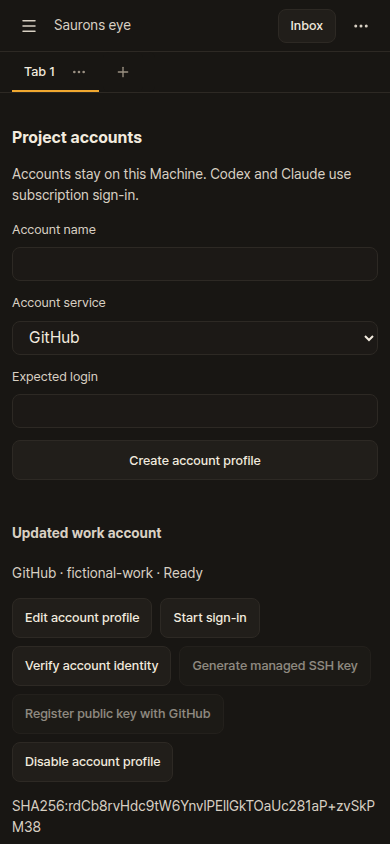

# Set up accounts for a Project

Open an Implementation, select its Project and execution Machine, then expand **Project
execution settings → Project accounts**. A Machine must already have a verified Project
checkout. Remote profiles and keys are created by that Machine's bridge.

1. Create an account profile with a descriptive name, service and expected login. GitHub expects
   a GitHub username; Codex, Claude and Cloudflare expect the subscription/OAuth email. For
   Cloudflare, also enter the exact 32-character account ID from its dashboard.
2. For GitHub, select **Generate managed SSH key**. The Machine creates one private Ed25519
   key; the interface shows its public key and SHA-256 fingerprint.
3. Select **Start sign-in**, open the authorization page and choose the intended account. Enter
   the displayed device code where requested. GitHub may require **Continue sign-in** before it
   begins polling. Claude may request a native authorization response: paste it into the password
   field and submit it once. Do not paste access tokens into notes or Project environments.
4. Wait for **Ready**, or use **Verify account identity**. A wrong login, expired credential,
   missing CLI or unsupported native auth contract stays unavailable. Codex and Claude must use
   subscription logins; API-key and third-party billing are refused.
5. For GitHub SSH, explicitly select **Register public key with GitHub** after verification.
   Existing matching registrations are reconciled before another request is made. HTTPS Git
   uses the selected private `gh` credential helper. SSH resolves existing host aliases but
   offers only this profile's registered key and retains OpenSSH host verification.
6. Choose each profile in the Project's service selectors and select **Save Project accounts**.
   **Current Machine account** keeps the existing behavior for a service without a binding.

Account **Ready** means native authentication matched the expected identity. Factory provider
readiness separately requires genuine skill loading and the recorded owner-question round for
the selected account revision. A successful fixture check cannot certify a personal subscription.
An existing verification for the Machine's ambient account does not certify a new bound account.
Subscription launchers also reject Claude API-key helpers and conflicting auth settings in
private, Project, main-checkout local or explicit CLI settings. Session overrides pin subscription
login so lower-priority Project settings cannot silently select API billing.

## Native tools and storage

| Service | Native setup and identity | Private selection |
| --- | --- | --- |
| GitHub | `gh auth login --web` with explicit SSH/public-key authorization; `gh api user` | Separate `GH_CONFIG_DIR`, file storage, ambient tokens removed. Global `gh` and SSH configs are preserved. |
| Codex | `codex login --device-auth`; app-server `account/read` without credential refresh | Separate `CODEX_HOME`, file auth, forced ChatGPT subscription and native OpenAI provider. |
| Claude | `claude auth login`; `claude auth status` | Separate `CLAUDE_CONFIG_DIR`; subscription method and matching native `configDirectory` required. Update Claude Code to a version exposing that field (documented from 2.1.268). |
| Cloudflare `cf` | `cf auth create` device login; `cf auth whoami --profile` | Separate XDG config and an explicit `saurons-…` native profile; explicit resource account ID. |
| Wrangler | `wrangler login --device --browser=false`; `wrangler whoami --json` | Separate native home and XDG config, including isolation from legacy `~/.wrangler`. No unsupported `whoami --profile` flag. |

Install native tools on the selected execution Machine using their official instructions. The
application does not install a global CLI. Old versions without device login or the required
identity receipt fail visibly. Cloudflare command wrappers reject account/profile overrides,
credential-bearing project `.env` files and Wrangler configs naming another account. Resource
membership does not establish permission for every deployment or zone operation.

## Changes, cancellation and recovery

**Edit account profile** updates its name or expected identity and requires fresh verification.
A registered GitHub key locks that profile's account identity; create a new profile for another
account. **Disable account profile** keeps private/native files and the public key for recovery;
it does not revoke the GitHub registration or delete the native account. Change/re-authentication
controls refuse while accepted or uncertain Runs use the profile.

An accepted Run freezes Machine identity, profile IDs, revisions and verified native identities.
Its coordinator, workers and checks inherit that scope through private launchers. Changing
Project defaults affects future Runs. Missing, changed or expired profiles fail closed. These
bindings apply to app-managed factory work; ordinary manually opened terminals keep their
existing account selection.

**Cancel sign-in** terminates only the child process started by this bridge, with a bounded
termination deadline. Setup expires after ten minutes. Reloading the browser and selecting
**Start sign-in** retrieves a still-live challenge from the same bridge; authorization input is
not replayed. After a bridge restart, **Recover interrupted sign-in** releases an old lease only
when its recorded process is no longer running. A live or unreadable lease stays blocked: inspect
the native process on its Machine. Recovery never kills a process just because its PID is in an
old file. After operator recovery, verify the selected identity before binding it again.

Profile state lives in the Machine's private `accounts/` directory beside factory state. Registry
publication uses atomic rename, files 0600 and directories 0700. Keys and native login caches
are excluded from factory backups and restored execution copies. Private paths and known
literal credentials are removed from imported native history; capture/upload controls reject
known account credential material, and retained check output receives the same redaction.
GitHub verification requires this profile's native file credential and cannot fall back to a
global OS keychain login. Original native CLI histories remain on their Machine.

Account selection is a convenience and consistency mechanism. Same-user native processes can
read other credentials or bypass a launcher; it does not provide tenant isolation or make an
arbitrary command safe. Keep external publication/deployment within its separately approved
scope. Use separate OS users or containers when enforced separation is required.

Owned API and Playwright fixtures cover identity/storage separation, managed keys, authorization,
expiry, cancellation, Project/Run freezing, HTTPS credentials, worker inheritance, remote Machine
ownership and retention guards. Full Linux checks run locally; lean GitHub CI is enabled while
publication workflows remain disabled. See [CI controls](ci-activation.md).
The owner still completes actual OAuth/subscription authorization; no personal login is created
by the automated tests.

Native contracts: [GitHub CLI](https://cli.github.com/manual/gh_auth_login),
[Codex authentication](https://learn.chatgpt.com/docs/auth),
[Codex app-server](https://learn.chatgpt.com/docs/app-server),
[Claude CLI](https://code.claude.com/docs/en/cli-reference),
[Cloudflare cf](https://developers.cloudflare.com/fundamentals/tools/cf/),
[Wrangler device login](https://developers.cloudflare.com/workers/wrangler/commands/general/),
[Wrangler config path source](https://github.com/cloudflare/workers-sdk/blob/main/packages/workers-utils/src/global-wrangler-config-path.ts).
