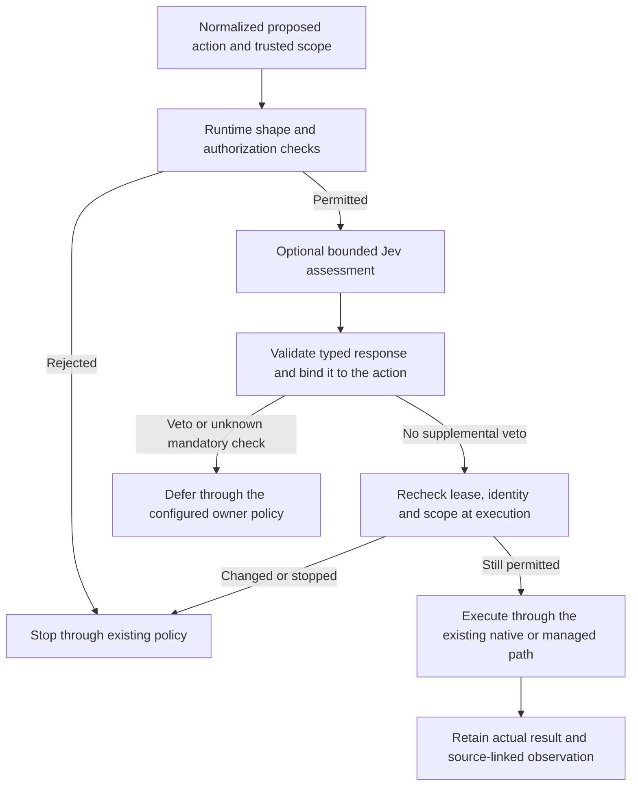

# Jev guardrails research

Research date: 2026-10-10. This note evaluates TypeSafe AI's Jev as an additional security signal and a possible way to reduce model costs. It proposes no installed integration. No CLI configuration, credentials, paid API requests, or production state were changed.

Jev is worth evaluating as an advisory classifier for narrowly defined hazards. Its typed answers do not establish authorization, executable safety, or passing validation. A guardrail-only integration adds requests and latency; token savings require a separate change that actually removes work or context from the expensive model. For Saurons eye, native CLI interception must be proven per provider rather than inferred from the browser/server bridge.

## Research: product and interface

The vendor is [TypeSafe AI](https://typesafe.ai/); its primary documentation is [docs.typesafe.ai](https://docs.typesafe.ai/introduction). Similarly named Jev guide sites and resellers are not the vendor.

Jev evaluates a text/structured `state` against named typed questions through `POST https://api.typesafe.ai/v1/systemone`, using bearer authentication. Answers retain question IDs and report model/version and token usage. Output-token usage can be nonzero even though the model page prices output as free; token counts and billed cost are separate. Questions evaluate independently against the shared state. [API reference](https://docs.typesafe.ai/api), [introduction](https://docs.typesafe.ai/introduction), [output pricing](https://docs.typesafe.ai/models)

| Primitive | Documented answer | Possible guardrail use, proposed |
| --- | --- | --- |
| Choice | Selected option, per-option probabilities, confidence | Classify the hazard: secret exposure, destructive change, unrelated instruction, unclear |
| Score | Probability-weighted position on an ordered rubric, distribution, confidence | Rate impact or reversibility using described levels |
| Noul | Probability from 0 to 1 that a yes/no proposition holds; no separate confidence | Ask whether an action follows instructions embedded in untrusted content |

These shapes are vendor facts from the [primitive reference](https://docs.typesafe.ai/primitives); the rightmost column is a proposed application. Choice/Score confidence describes concentration of the answer distribution, rather than an independently verified probability of correctness. [Confidence](https://docs.typesafe.ai/confidence)

The official TypeScript/JavaScript SDK is `@typesafe-ai/sdk`, with inferred answer types and `choice()`, `score()`, and `noul()` helpers. The reviewed SDK source validates request questions but parses successful response bodies and casts them to the generic result type; it does not prove their runtime shape or meaning. A security integration should validate returned question IDs, discriminants, finite probability ranges, rubric/option membership, and the expected model before using the signal. Keep the key on the server. [JavaScript SDK](https://docs.typesafe.ai/sdk/javascript), [SDK client source](https://github.com/typesafe-ai/typesafe-sdk-js/blob/main/src/client.ts)

Jev does not generate code or replace the LLM behind a coding CLI. Installing TypeSafe's agent skill teaches integration details; it does not itself intercept or police the CLI's tools. [Jev with coding agents](https://docs.typesafe.ai/introduction/coding-agents)

### Current model limits and pricing

The official model page lists `jev-1.13.0`, with `jev-latest` and `jev-preview` currently pointing to that version. It lists **$0.042 per million input tokens; output tokens free**. Context is 64k tokens for state plus all questions, and 32k for state plus the longest individual question. Inputs are text/JSON only; images, audio, and video require preprocessing. An assessment of a picture's caption/OCR is therefore an assessment of derived text, not its pixels. English performs best; other languages need workload evaluation. Rate limits are described as changing dynamically. Pin a version when calibrating a security policy, and record the response version. [Models](https://docs.typesafe.ai/models)

The vendor reports 70–500 ms end-to-end response times, measured primarily from the US West Coast. That is a vendor measurement, not this application's observed latency or an SLA. Network distance, process startup, state size, concurrency, failures, and retries also matter. [Launch post and methodology](https://typesafe.ai/blog/introducing-system-one-models-and-jev)

## What protection it can add

The official guardrail cookbook screens incoming prompts and outgoing replies with hazard probabilities and a severity rubric, then branches in code. It provides a useful integration pattern, but its displayed results replay cached `jev-1.12` responses from 2026-08-15 for ten prompts and five replies. It is not an adversarial native-command acceptance suite. [Guardrails cookbook](https://docs.typesafe.ai/cookbooks/llm_guardrails)

The vendor's current failure-mode document explicitly says adversarial state can steer answers; large irrelevant state reduces accuracy; indirection, literal wording, and Choice option order can also matter. A concentrated distribution can still confidently favor the wrong decision. [Jev 1.13 limitations](https://docs.typesafe.ai/model-jaggedness/jev-1.13)

The following separation is an architectural recommendation:

| Check | Authority remains with |
| --- | --- |
| JSON shape, argument types, size/MIME/hash, canonical paths | Deterministic application validation |
| User scope, capability, Machine/Run identity, current lease, permissions | Application and native executor authorization |
| Git/worktree identity, current reviewed head, check exit status, owner acceptance | Existing workflow/evidence gates |
| Suspicious intent, likely injection, semantic off-task behavior | A fallible Jev signal that may request review or deny additional work |

A low risk score must never grant filesystem authority, claim a lease, answer an owner approval, accept a review, or authorize publication. Passing the classifier means only that the classifier did not veto; all existing controls still apply. Keep deterministic checks before and at the executor, and retain native approvals and sandbox limits.

### Native CLI interception

These are fetched provider capabilities, not tested adapter coverage:

| CLI | Available integration point | Material limit |
| --- | --- | --- |
| Codex | Synchronous `PreToolUse` can deny supported local tool calls; `PostToolUse` observes outputs. `PermissionRequest` runs only when native approval is needed. [Hooks](https://learn.chatgpt.com/docs/hooks) | Hosted WebSearch is outside these hooks; `write_stdin` input does not receive a second pre-tool check. Unsupported pre-tool `ask`/continuation fields can fail the hook while the tool continues. Callback failure is not a guaranteed deny. [Hooks](https://learn.chatgpt.com/docs/hooks), [managed hook failure behavior](https://learn.chatgpt.com/docs/enterprise/managed-configuration) |
| Claude Code | `PreToolUse` supports deny/ask and input inspection; `PostToolUse` can inspect or replace results. [Hooks reference](https://code.claude.com/docs/en/hooks) | Ordinary command/HTTP hook failures and timeouts continue by default. `onFailure: "block"` requires v2.1.295+. Hook-requested ask cannot be silently approved in auto mode from v2.1.211. Prompt `@file` expansion does not call a tool hook. [Hooks reference](https://code.claude.com/docs/en/hooks) |
| OpenCode V1 | `tool.execute.before` can throw to block; after hooks can inspect output. [Plugins](https://opencode.ai/docs/plugins/) | Plugin and permission wiring must match the installed version; a warning is not a permission prompt. Preserve ordinary permissions. |
| OpenCode V2 | `ctx.tool.hook("execute.before", …)` inspects input; `ctx.permission.hook("evaluate", …)` can change allow/ask decisions, while configured deny remains final. [Plugin API](https://opencode.ai/v2/docs/build/plugins) | V1 returned-hook APIs do not translate automatically into V2 APIs. The documented dual-entry V1 object form is supported from V1 1.18.29; older V1 versions may require function exports. [Plugin API](https://opencode.ai/v2/docs/build/plugins) |

Non-managed Codex hooks require trust, and their scripts must exist on the execution Machine. Installing a plugin does not activate its hook merely by name. [Codex hook configuration](https://learn.chatgpt.com/docs/config-file/config-advanced), [plugin hook trust](https://developers.openai.com/plugins/build/plugins)

This host has Codex 0.162.1; Claude/OpenCode were absent on PATH during the preceding research. The fetched Codex hook page establishes no minimum release for every behavior above. Verify actual event payloads, trust, malformed output, crash/timeout behavior, subprocesses, child agents, remote execution, and side-effect timing before claiming coverage. Post-tool checks cannot undo already executed actions. Those acceptance requirements are recommendations, not completed tests.

### Upstream-owned examples, not vendor packages

[leepokai/jev-guard](https://github.com/leepokai/jev-guard) demonstrates native hooks and an OpenCode plugin. Its README acknowledges Codex's missing pre-tool ask support and distinguishes live tests from payload tests. Its default outage policy is fail-open. The reviewed OpenCode adapter returns automatic allow decisions through `permission.ask`; a probabilistic user-request check can reduce prompts. Those behaviors do not fit this application's requirement that classifier judgments add no authority. Reuse concepts only after reviewing pinned source and changing the policy accordingly. [OpenCode adapter source](https://github.com/leepokai/jev-guard/blob/main/src/opencode.js)

[harshwasan/jev-sentinel](https://github.com/harshwasan/jev-sentinel) illustrates session taint, scope pinning, output screening, and best-effort secret scrubbing. Its own documentation names scrubbing gaps and truncation limits. Neither repository proves complete native coverage or our workload's security accuracy; both are primary examples of their authors' implementation, not TypeSafe-maintained products.

## Data handling and deployment

TypeSafe's privacy policy covers API inputs and says they are not used to train/fine-tune models. It allows service-provider processing, describes retention as reasonably necessary, and identifies US hosting/processing. It does not promise standard-account zero retention or a fixed universal retention period. Enterprise ZDR is available by account arrangement; verify its actual scope before sending private transcripts or documents. [Privacy policy](https://typesafe.ai/legal/privacy-policy), [enterprise offering](https://typesafe.ai/enterprise)

The standard customer agreement describes a TypeSafe-hosted API, telemetry processing, and possible confidential-information retention in standard backups. Public documentation fetched here did not establish generally available Jev weights, a self-hosted model distribution, or a deployable VPC/on-premises package. An enterprise FAQ asks about VPC/on-premises but does not establish terms in the fetched page. Treat these deployment options as unresolved, rather than assuming a local SDK/proxy makes inference local. [Customer agreement](https://typesafe.ai/legal/mca), [enterprise page](https://typesafe.ai/enterprise)

Recommended state minimization: send the normalized proposed action, trusted owner scope, relevant current policy/identity facts, and the smallest necessary untrusted excerpt. Keep trust labels explicit; exclude capability tokens, credentials, unrelated personal data, and whole transcripts by default. Any redaction is best effort, so it does not establish that a payload is public. Hash-only audit records and actual submitted-state inspection should be available without exposing secrets to ordinary agents.

## Evidence quality

Vendor speed/cost multipliers compare selected structured workflows. The vendor explicitly notes that its team designed the evaluations, frontier-model predictions act as reference answers, short inputs favor the demo, and sustainability of pricing is not yet proved. Those figures do not establish independent security protection or token savings for this repository. [Vendor methodology](https://typesafe.ai/blog/introducing-system-one-models-and-jev)

A recent independent primary preprint, submitted 2026-10-04, reports useful injection/jailbreak detection on several benchmark sets and also successful manipulation of typed Jev decisions. Its hosted-model study and its independent local NanoJev poisoning experiments are different; NanoJev is not evidence that TypeSafe ships local Jev weights. The paper is an arXiv preprint, and its test distributions/thresholds do not certify native CLI tool gating here. [Hidden Risks of Jev, v1](https://arxiv.org/html/2610.04985v1)

## Tokens, cost, and a hypothetical break-even model

Adding a call before and after an unchanged native model/tool loop adds billed input, latency, and potentially review turns. It does not inherently reduce the native model's context or reasoning. Savings become plausible if a measured integration replaces an expensive classifier, filters irrelevant references before insertion, routes compatible work to a cheaper model, or prevents a wasteful turn before it happens. Post-execution screening cannot save that completed execution. Saurons eye does not automatically control provider routing inside every native CLI.

For a **hypothetical linearly billed API workload**, define:

```text
Jev cost = total Jev billed input tokens × Jev input price / 1,000,000
Net savings = avoided downstream billed cost
              − Jev cost − extra retries/review/infrastructure cost
```

At the currently documented Jev rate, 10,000 checks averaging 2,000 billed input tokens cost `$0.84`, assuming one request per check and no retries. If a hypothetical downstream API costs `$3/M` input tokens, avoiding 280,000 of those tokens just covers `$0.84`; avoiding 300,000 saves only `$0.06` before other costs. The `$3/M` rate is an invented example, not a provider quote. Two screens per action double classifier input under these assumptions. [Jev pricing](https://docs.typesafe.ai/models)

A subscription CLI may show reduced usage or more available turns without a corresponding invoice reduction. Measure actual billed totals and cached/uncached input, output/reasoning tokens, retries, abandoned turns, human-review time, and latency; do not equate different providers' token counts or nominal prices with realized savings.

Free output billing does not mean zero output usage: the API's example reports both input and output tokens. Keep provider-specific token totals alongside billed cost, rather than reporting all Jev output as zero. [API usage fields](https://docs.typesafe.ai/api)

## Fit with the current application

Source inspected at `07f5e3f5a546cee698710800cd8e0884370a4743`; the later local research commits change documentation only.

| Existing module | Source observation | Implication for a Jev integration |
| --- | --- | --- |
| Scoped tracker | `handleAgent` authenticates a Run capability, checks closed state and origin/header, permits known actions, and delegates workflow validation | Keep these deterministic checks. A low-risk answer cannot authorize a new action or another Run. [Tracker](../../server/factory.ts) |
| Admission and execution ownership | `FactoryRuntime` freezes scope; `FactoryPipeline` reserves workers; the host verifies worktree/branch/repository identity | Jev can inspect selected semantic evidence after permission checks, but must not allocate resources or overrule identity/capacity failures. [Runtime](../../server/factory-runtime.ts), [pipeline](../../server/factory-pipeline.ts), [worktrees](../../server/factory-worktrees.ts) |
| Configured check recipes | `runFactoryCommand` uses argument arrays with `shell: false`, bounded time/output and owned cancellation | This avoids bridge-level shell interpolation; it is not an OS sandbox for the invoked program. A test runner or program can execute further code. Semantic scoring cannot prove that code's effects. [Command execution](../../server/factory-command.ts) |
| Native agent tools | `FactoryNative` starts an installed CLI through Herdr, preserving native controls | The app is not the executor of every internal Bash/Edit/network tool. An HTTP middleware in this server would not intercept those calls. Native hook coverage needs separate provider/version acceptance. [Native adapters](../../server/factory-native.ts) |
| Final validation and acceptance | Acceptance checks the current head/workspace hash, passed checks, separate Standards/Spec evidence, completed Tickets and resolved findings | A Jev result can add a risk finding. It cannot count as a passed check, replace either independent review or perform owner acceptance. [Acceptance](../../server/factory-pipeline.ts) |

The TypeScript wire types are compile-time contracts; HTTP JSON remains untrusted input and needs runtime checks. Consolidating runtime schemas and policy checks is a separate deterministic improvement. TypeSafe AI's brand and typed result shape do not replace that work. [Shared protocol](../../shared/protocol.ts), [request validation](../../server/factory.ts)

### Candidate pilot locations

These are design proposals, not implemented protection:

1. **Validation evidence triage.** Inspect a bounded, source-linked candidate diff and selected check/review evidence for unusual credential handling, newly introduced external connections, or semantic inconsistency with owner scope. Preserve full original evidence centrally. Exact exit statuses, head hashes and permissions remain code checks. Return a risk observation for the owner or independent reviewers.
2. **Project reference ingestion and retrieval.** Assess selected untrusted text for attempts to redefine authority or request unrelated actions. This complements the proposed [Project reference library](project-reference-library.md). A suspicious label can request review; a benign label must not elevate a document into owner instructions. Keep required project rules, approvals and evidence out of relevance-pruning decisions. Captions/OCR represent derived text, not a full-image safety check.
3. **Selected native pre-tool calls.** Only after actual hook tests show interception and denial before side effects, evaluate normalized tool arguments plus trusted scope and current identity facts. Document unobserved tools and subprocess limitations. Do not advertise this as a universal cross-CLI guard merely because the adapters share a decision module.

The first pilot can record observations without affecting actions or adding approval prompts. This measures whether Jev adds useful information to the existing validation step. Native enforcement and context pruning should be separate experiments, so security accuracy and token savings are not conflated.

### Proposed decision flow



In shadow mode the Jev branch records an observation without changing the existing action decision. An advisory assessment performed after execution can help audit or screen a result, but offers no preventive protection for the completed side effect.

One Guard Assessment module should own provider requests, deadlines, response validation, semantic observation caching and audit metadata. Its interface should return an observation bound to a normalized action fingerprint, with `unknown` represented explicitly. It should expose no operation that creates authority. The actual executor owns authorization and the final state check.

Keep model/version, question/criteria and policy versions in each retained observation. Bind the action to its Project, Run/worker, Machine, current lease/generation, cwd, tool arguments, source hashes and relevant head/workspace identity. Data that cannot be captured faithfully makes the assessment incomplete. After a network await, rerun the executor's current-state checks; delayed Jev replies must not revive work after Stop. A partial excerpt assessment certifies no unexamined remainder.

Jev would be a new external service for this fork. Keep it off until explicitly configured for the selected scope, pass no agent capability token or API credential in classifier state, and store the provider key outside native context. Use the existing `createServer(options)` configuration seam. Researching or installing an SDK is not permission to send project documents or transcripts to the hosted API.

## Proposed pilot and enforcement rules

Start with a bounded shadow-mode evaluation on fictional/owned data and existing application-controlled requests or reference ingestion. Record Jev suggestions while preserving current execution decisions. Shadow mode itself has no blocking protection and still costs requests and latency. After held-out evaluation, enable narrow veto/escalation only at proven interception points. The following rules are recommendations:

- Deterministic rejection and existing owner/native controls always win. A benign classifier result returns no additional approval and never expands writable directories or changes sandbox policy.
- Separate trusted scope/policy from untrusted content. Bind each signal to the exact normalized action and immutable state snapshot. Truncated, unsupported, invalid, or missing evidence is unknown.
- Cache semantic observations only with model/version, question/criteria hash, policy/threshold version, action/argument hash, input provenance/content hash, Project/Run/Machine/checkout identity, relevant permissions, and current lease/generation. A change invalidates the observation. A cached low-risk result is never a durable authorization.
- Revalidate authority, lease, stopped state, canonical paths, and Git/head identities at execution after any network await. Check cancellation and expiry. An action judged before a Stop or path replacement must not run afterward; this is a time-of-check/time-of-use concern.
- Set bounded overall deadlines and retry budgets. On failure, preserve existing controls; mandatory supplemental checks deny/defer when their gate is unavailable. Optional advisory checks may remain advisory but must report degraded coverage. Native hooks that themselves fail open cannot claim mandatory enforcement until a tested host-supported failure policy closes that gap.
- Keep owner review/acceptance and publication gates explicit. A classifier may flag a validation report for deeper review; it cannot replace tests, security scanning, independent reviews, or fresh evidence.

A minimal benchmark should use the same tasks, configurations, and versions for baseline, shadow, and veto modes, with separate threshold-tuning and held-out sets. Include legitimate maintenance and adversarial documents/tool outputs; commands that hide file/network side effects in subprocesses; paths/symlinks and concurrent mutation; explicit owner-scoped requests; Stop/lease races; long/non-English inputs; outages, 429/overload, malformed answers, hook failures, and duplicate delivery. Use owned temporary resources; fixtures must not execute destructive commands against live state.

Report security false allows by severity, benign false blocks/review frequency, task completion/correctness, gate coverage/bypasses, calibration, total billed cost/tokens, and p50/p95 end-to-end latency. Record versioned inputs and replayable receipts. Safety and task success must be acceptable before optimizing cost. This research did not run that benchmark, so no protection percentage, token-saving percentage, or break-even result is claimed.
