# Saurons eye feature screenshots

Playwright drives the real React client and Bun backend using a disposable herdr configuration,
temporary application state and an owned fictional Git repository. Records are created through
the public API; navigation, previews, review capture, draft findings, backup and restore use the
actual browser controls. The desktop view is 1600 × 1000; the touch-enabled phone view is
390 × 844. Click a thumbnail for the original PNG.

| Feature | Desktop | Phone |
| --- | --- | --- |
| **Global Inbox:** capture ideas before choosing a Project; follow progressed work in Assignments | [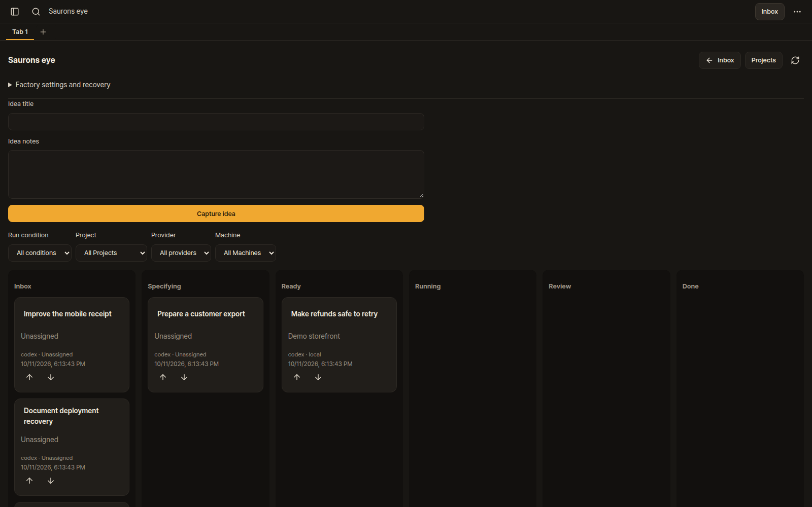](screenshots/fork-features/inbox-desktop.png) | [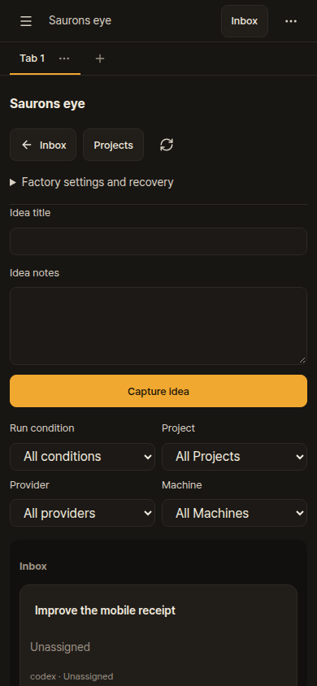](screenshots/fork-features/inbox-mobile.png) |
| **Notes:** durable context, chats and explicit Save | [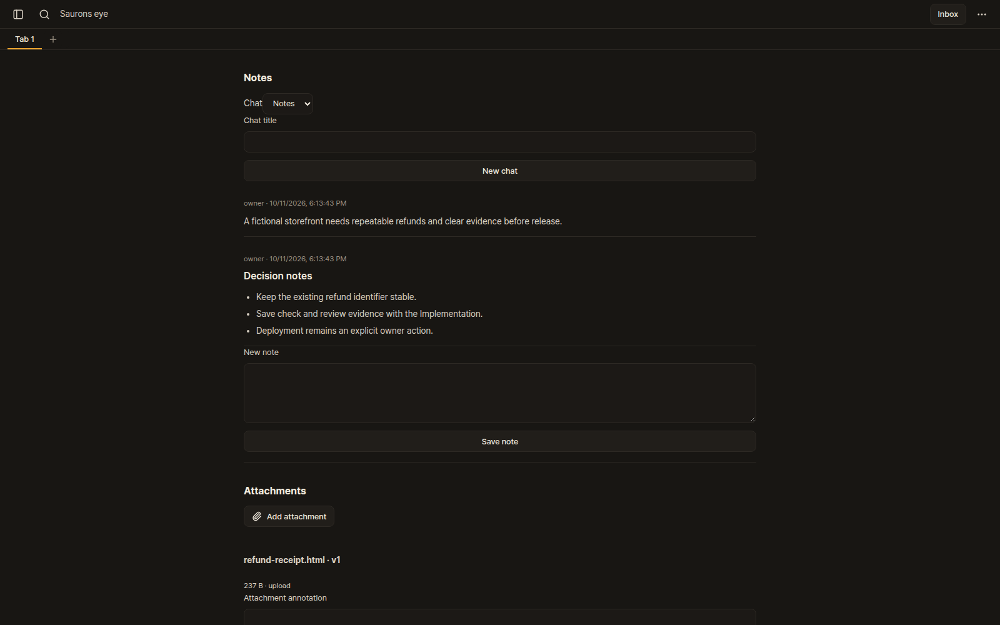](screenshots/fork-features/notes-desktop.png) | [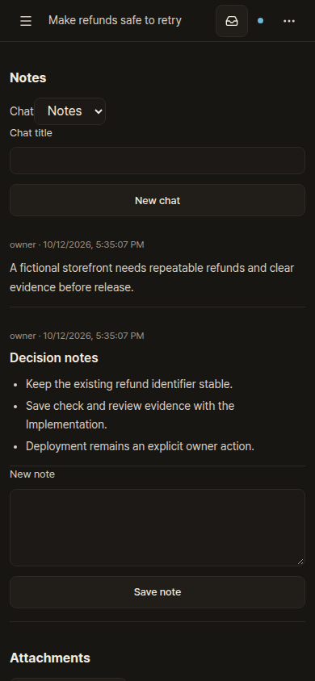](screenshots/fork-features/notes-mobile.png) |
| **Attachments:** retained versions, annotations and sandboxed HTML preview | [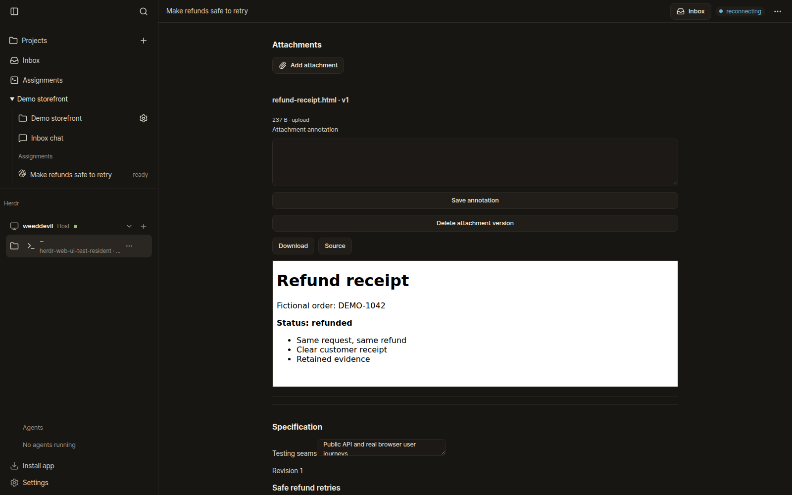](screenshots/fork-features/attachments-desktop.png) | [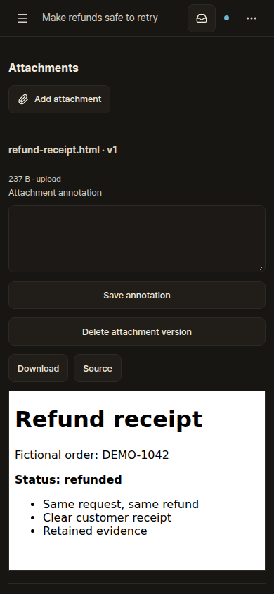](screenshots/fork-features/attachments-mobile.png) |
| **Project references:** shared documents and pictures outside Git, reading policies and version history | [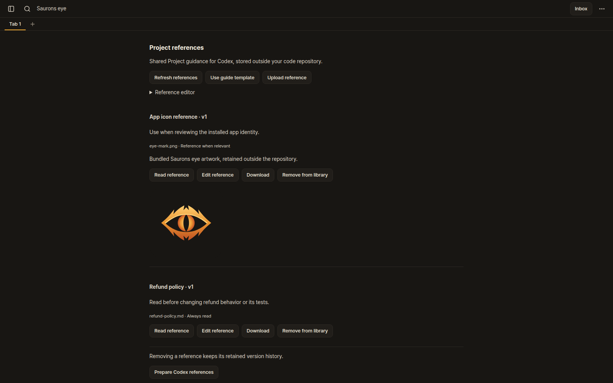](screenshots/fork-features/references-desktop.png) | [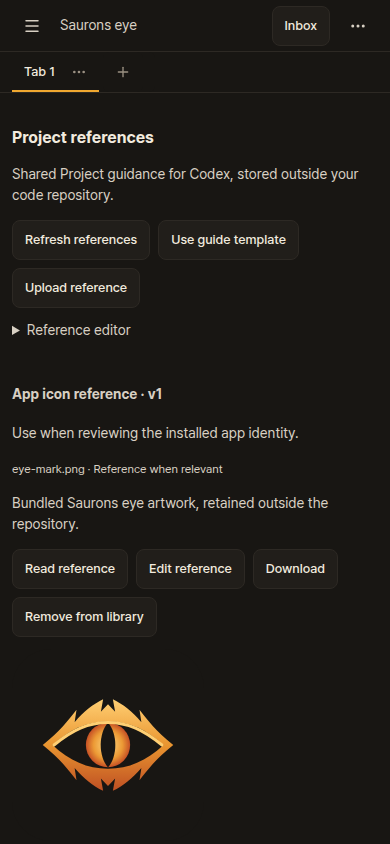](screenshots/fork-features/references-mobile.png) |
| **Specifications:** versioned acceptance and explicit testing seams | [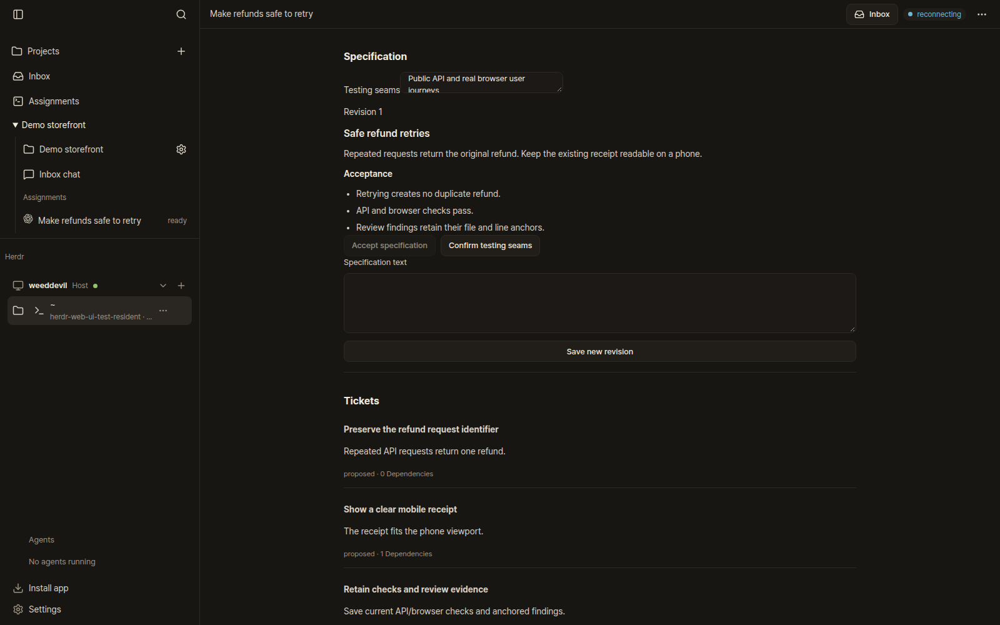](screenshots/fork-features/specification-desktop.png) | [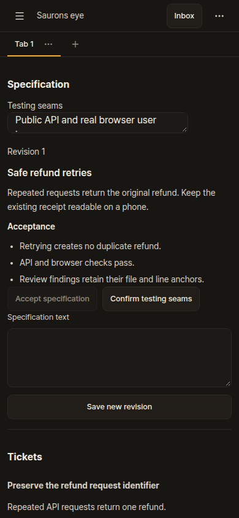](screenshots/fork-features/specification-mobile.png) |
| **Tickets:** accepted dependency graph and acceptance criteria | [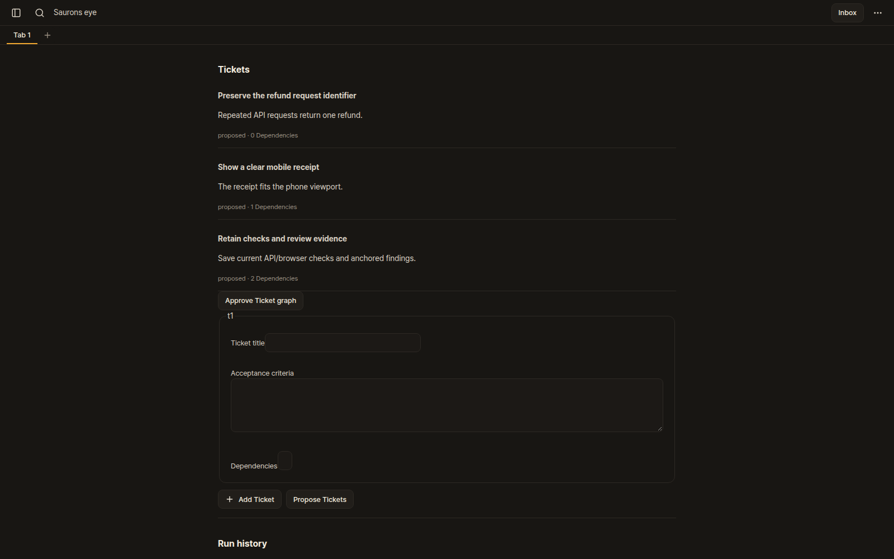](screenshots/fork-features/tickets-desktop.png) | [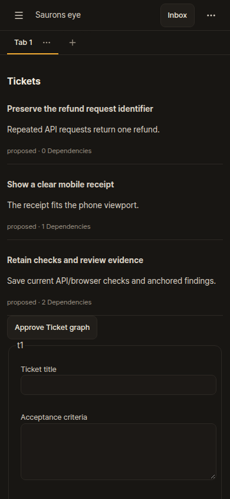](screenshots/fork-features/tickets-mobile.png) |
| **Review:** immutable workspace capture, file/line anchors and saved draft findings | [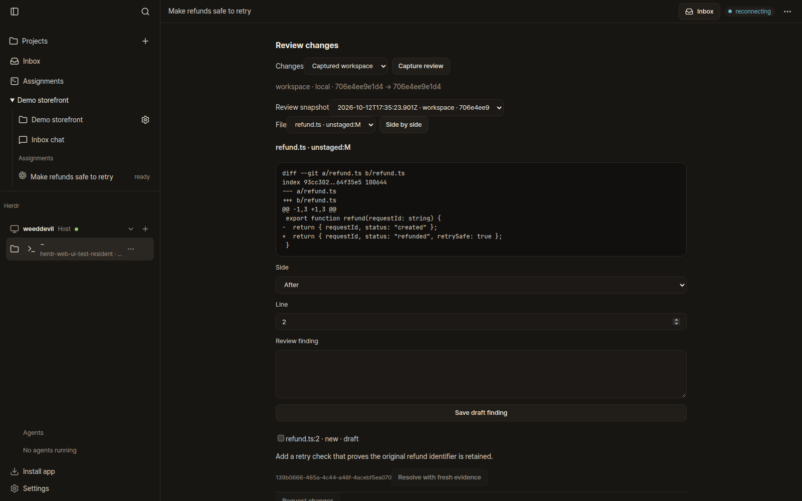](screenshots/fork-features/review-desktop.png) | [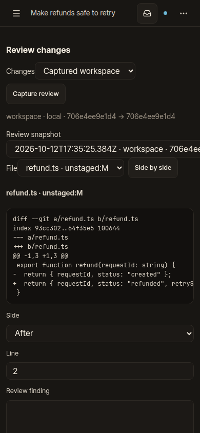](screenshots/fork-features/review-mobile.png) |
| **Recovery:** configurable limits, verified backup and an isolated restore with execution disabled | [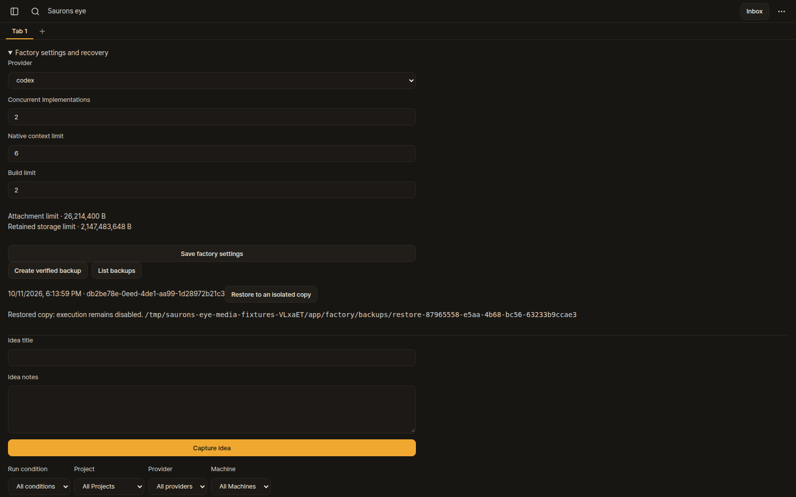](screenshots/fork-features/recovery-desktop.png) | [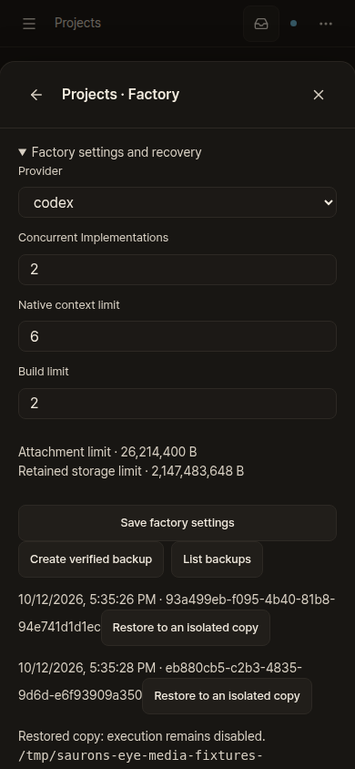](screenshots/fork-features/recovery-mobile.png) |

## Regenerate

Use the installed prerequisites and cached Playwright Chromium. Capture outside the checkout so
generated images do not change source while the verification report is being written:

```bash
bun run check run --build bun scripts/fork-feature-media.ts /tmp/saurons-eye-feature-media
```

The runner requires the check command's private configuration marker, uses port `0`, waits for
the isolated bridge, opens Inbox through the UI, and closes the desktop sidebar. Every capture
waits for its visible content and fonts. It rejects app alerts, browser exceptions and external
browser requests; cleanup closes browser/server state and removes the owned fixture repository.
It creates 16 PNGs plus `capture.json`. Review them, then copy only the filenames listed in that
manifest into `docs/screenshots/fork-features/`. Failed attempts can leave separately named
`*-failure.png` files in the temporary output directory; those are not gallery assets.

[Capture source](../scripts/fork-feature-media.ts) ·
[Capture metadata](screenshots/fork-features/capture.json) ·
[Checks and build provenance](development.md#checks) ·
[Playwright screenshots](https://playwright.dev/docs/screenshots) ·
[Device emulation](https://playwright.dev/docs/emulation)

## Coverage

The walkthrough verifies retained attachment/Ticket/finding records and a real verified backup
restored to a private copy. It never starts native provider work or invents provider verification;
Request changes remains unavailable without a native Run. The fixture's specification and graph
approvals are screenshot data. Native execution, account switching, automatic scheduling and
physical Android notifications require their own acceptance evidence.

Phone images show the viewport at the start of each section; controls below the fold remain
available by scrolling. Long review identifiers and diffs currently require horizontal navigation
on a narrow screen. These are screenshots of the current layout, with no UI styling substituted.
The existing [factory browser](../scripts/factory-browser-regression.ts),
[Project references browser](../scripts/project-references-browser-regression.ts) and
[PWA installation](pwa-installation.md) checks cover additional interactions and installability.
