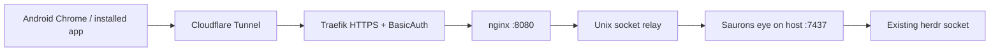

# Install Saurons eye with an existing herdr instance

This guide installs Saurons eye alongside the original herdr-web-ui plugin, then routes your
existing HTTPS address to the fork. Run the commands as `kurri` on the host that runs herdr.
The Docker containers continue to provide the proxy; the application runs on the host so it can
use the existing herdr socket and Node terminal sidecar.

The inspected setup on 2026-10-11 was:

| Setting | Existing installation | Saurons eye |
| --- | --- | --- |
| Plugin ID | `devswha.herdr-web-ui` | `usergood.saurons-eye` |
| Host listen address | `127.0.0.1:7317` | `127.0.0.1:7437` |
| Application state | `/home/kurri/.config/herdr-web-ui` | `/home/kurri/.config/saurons-eye` |
| herdr socket | `/home/kurri/.config/herdr/herdr.sock` | The same socket |
| Compose directory | `/home/kurri/docker/herdr` | The same proxy stack |
| Phone address | `https://herdr.glappet.eu` | The same address after cutover |

For another host, replace the username, paths, socket and domain. Choose another free port if
`7437` is occupied, and use it consistently in the configuration, checks and relay command.



## 1. Check the host

```bash
bun --version
node --version
herdr --version
git --version
python3 --version
herdr status server
test -S /home/kurri/.config/herdr/herdr.sock
herdr plugin list
```

The Linux plugin needs Bun 1.4+, Node 18+ and herdr 0.9.0+. The inspected host already had
Bun 1.4.2, Node 22 and herdr 0.9.3. Python 3 is used by the setup and verification snippets below.
herdr must answer and the socket check must exit successfully. Keep the original plugin and
herdr running throughout this procedure. Do not run `herdr update` or `herdr server stop`.

Check the proposed app port before installing:

```bash
python3 - <<'PY'
import socket
with socket.socket() as listener:
    listener.bind(("127.0.0.1", 7437))
print("Port 7437 is available")
PY
```

If `usergood.saurons-eye` is already installed, use [Updates](#updates) instead of replacing its
configuration. The initial setup below deliberately refuses existing settings.

## 2. Install the reviewed fork

This reviewed application commit includes the PWA fix, bundled eye artwork and GitHub workflows:

```bash
herdr plugin install usergood/saurons-eye \
  --ref c97b2cbd824a74996d4bb8835ada64a2535041c0 --yes
herdr plugin list --plugin usergood.saurons-eye --json
```

Installation builds and registers the plugin. Confirm its ID is `usergood.saurons-eye`, it is
enabled, and `source.resolved_commit` matches the requested commit. Registering the plugin does
not start its startup hook in the already-running herdr session; start it explicitly after
configuration. Future herdr server starts run the enabled plugin's hook.
[Herdr install and startup semantics](https://github.com/herdrdev/herdr/blob/7b116c05bfda646af39d2524c54e70c751f57ee8/docs/next/website/src/content/docs/plugins.mdx#startup-hooks)

Do not select an upstream release tag just because its version matches `package.json`: the fork's
additional features are on its reviewed commits, and a merge does not publish a fork release.

## 3. Create private configuration

Get the configuration directory from herdr. The app reads settings from this directory rather
than from the shell used to invoke a herdr action. `.env` takes precedence over the legacy `env`.

```bash
saurons_config_dir="$(herdr plugin config-dir usergood.saurons-eye)"
test -n "$saurons_config_dir" && test -d "$saurons_config_dir"
python3 - "$saurons_config_dir" <<'PY'
import os
from pathlib import Path
import secrets
import sys

directory = Path(sys.argv[1])
if not directory.is_absolute() or not directory.is_dir():
    raise SystemExit("Plugin configuration directory is missing")
if any((directory / name).exists() for name in ("env", ".env")):
    raise SystemExit("Settings already exist; preserve them and use the update procedure")
directory.chmod(0o700)
settings = (
    "HOST=127.0.0.1\n"
    "PORT=7437\n"
    "HERDR_SOCKET_PATH=/home/kurri/.config/herdr/herdr.sock\n"
    "HERDR_WEB_STATE_DIR=/home/kurri/.config/saurons-eye\n"
    "HERDR_WEB_APP_NAME=Saurons eye\n"
    "HERDR_WEB_AUTO_UPDATE=0\n"
    "HERDR_WEB_TAILSCALE_SERVE_ONLY=0\n"
    "HERDR_FACTORY_PUBLIC_URL=https://herdr.glappet.eu\n"
    f"HERDR_WEB_TOKEN={secrets.token_hex(32)}\n"
)
temporary = directory / ".env.setup.tmp"
fd = os.open(temporary, os.O_WRONLY | os.O_CREAT | os.O_EXCL, 0o600)
with os.fdopen(fd, "w") as file:
    file.write(settings)
os.replace(temporary, directory / ".env")
print(f"Private settings created at {directory / '.env'}; credential not displayed")
PY
```

This generates an independent app credential without printing it. Keep the file outside Git;
do not paste its contents into chat or a PR. A paired phone can sign in without copying that
credential. Keep Traefik BasicAuth as the outer gate as well.

`HERDR_SOCKET_PATH` is translated to the server's `HERDR_SOCKET` by the plugin launcher. The
separate app state keeps the fork's devices, push keys, updates and factory records independent
of the original installation. Do not copy the original state into it to bypass phone pairing.
Herdr separately provides the plugin's process-state directory for its PID and server log.

`HERDR_FACTORY_PUBLIC_URL` gives remote workers the deployed callback address. A future remote
worker must be able to reach and authenticate through the proxy too; this URL alone does not
grant access. See [factory configuration](factory/runtime.md#start-and-configure).

## 4. Start and verify locally

```bash
herdr plugin action invoke usergood.saurons-eye.start
```

The action acknowledgement means it was queued. Use the bounded check below to wait for the
running bridge, verify it connects to herdr, and confirm the fork's actual HTML and manifest:

```bash
python3 - <<'PY'
import json
import time
import urllib.request

origin = "http://127.0.0.1:7437"
deadline = time.monotonic() + 35
last_error = "No response"
def read(path):
    with urllib.request.urlopen(origin + path, timeout=2) as response:
        return response.read()
while time.monotonic() < deadline:
    try:
        health = json.loads(read("/api/health"))
        manifest = json.loads(read("/manifest.webmanifest"))
        page = read("/").decode()
        assert health["ok"] is True and isinstance(health["herdr"], dict)
        assert health["auth"]["required"] is True, "App credential gate is missing"
        assert manifest["name"] == "Saurons eye"
        assert manifest["display"] == "standalone" and manifest["id"] == "/"
        assert 'crossorigin="use-credentials"' in page
        print("Saurons eye is ready; herdr answered; app authentication is required")
        break
    except Exception as error:
        last_error = str(error)
        time.sleep(min(0.25, max(0, deadline - time.monotonic())))
else:
    raise SystemExit(f"Startup check failed: {last_error}")
PY
```

Continue only after success. On failure, inspect the fork's command log:

```bash
herdr plugin log list --plugin usergood.saurons-eye --limit 5
```

An explicit `PORT` is never silently changed. Fix a socket, tool-path or port error before
cutover. Do not restart herdr to restart this app.

## 5. Point the existing Docker relay at the fork

Save unsent drafts and close browser tabs using the original app before testing a terminal in
the fork. Two application servers attaching the same pane can leave the second waiting for the
first holder; a retry does not take over that pane.

Make a private rollback copy of the existing Compose file:

```bash
cd /home/kurri/docker/herdr
umask 077
saurons_compose_backup="docker-compose.yml.before-saurons-eye.$(date +%Y%m%d-%H%M%S)"
cp --no-clobber docker-compose.yml "$saurons_compose_backup"
chmod 600 "$saurons_compose_backup"
```

In `docker-compose.yml`, change **only** the TCP target in `herdr-relay.command`:

```diff
 services:
   herdr-relay:
     command:
       - "UNIX-LISTEN:/run/herdr/herdr.sock,fork,unlink-early,umask=0000,mode=0666"
-      - "TCP4:127.0.0.1:7317"
+      - "TCP4:127.0.0.1:7437"
```

`/run/herdr/herdr.sock` here is the relay's **HTTP proxy socket inside Docker**. It is different
from the host's native herdr API socket in step 3. Keep the relay's `network_mode: host`, socket
volume, nginx configuration, Traefik labels, BasicAuth and Cloudflare Tunnel route.

Validate without printing the resolved configuration, which contains authentication settings,
then recreate only the relay:

```bash
docker compose config --quiet
docker compose up -d --no-deps herdr-relay
docker compose ps herdr-relay herdr-proxy
```

Compose recreates a service whose configuration changed and preserves its mounted volumes.
`--no-deps` limits this operation to the relay; the command-only change needs no image rebuild.
Existing browser connections may reconnect during this step.
[Docker Compose up reference](https://docs.docker.com/reference/cli/docker/compose/up/)

## 6. Pair the phone and install the Android app

Retrieve the installed checkout from the plugin registry rather than guessing a directory name:

```bash
saurons_plugin_root="$(herdr plugin list --plugin usergood.saurons-eye --json |
  python3 -c 'import json,sys; rows=json.load(sys.stdin)["result"]["plugins"]; matches=[p for p in rows if p["plugin_id"] == "usergood.saurons-eye"]; assert len(matches) == 1; print(matches[0]["plugin_root"])')"
test -f "$saurons_plugin_root/scripts/plugin.ts"
bun "$saurons_plugin_root/scripts/plugin.ts" pair
```

Run `pair` in your own terminal: it deliberately displays a six-digit, single-use code valid for
ten minutes. Keep that code out of logs and shared screenshots. The helper reads the private
configuration and authenticates to the fork on port `7437`.

1. Open `https://herdr.glappet.eu` in **normal Android Chrome** and pass Traefik BasicAuth.
2. Enter the new pairing code when Saurons eye asks. The original app's device cookie is not a
   credential for the fork's new state. Confirm the page says **Saurons eye** and shows the eye.
3. In Chrome's menu, choose **Install and create shortcut → Install**; older Chrome versions
   use **Install app** or **Add to home screen → Install**. Follow the installation prompt.
4. Open the installed app from its eye icon. In its **⋯ menu → Alerts**, turn alerts on and
   accept notification permission.
5. In **Settings → Alerts → Test notification**, choose **Send test**. Check the phone's
   notification, its application attribution and icon, and that tapping it opens the app.
6. In **Android Settings → Apps**, confirm **Saurons eye** is installed and notifications are
   allowed. Repeat the test with the app in the background.

Chrome installs an Android WebAPK when the installation path is available; a launcher shortcut
alone does not establish that app identity. Installation and notification permission are
separate steps. Android and Chrome control the final notification presentation, so verify it
on the phone. [Chrome Android installation](https://support.google.com/chrome/answer/9658361?co=GENIE.Platform%3DAndroid),
[WebAPKs and permissions](https://web.dev/articles/webapks)

Keep HTTPS and authentication on the whole hostname, including the manifest, icons and service
worker. The merged manifest link carries login credentials, so no BasicAuth exemption is needed.
An anonymous `curl` returning 401 at the public address is expected. If installation is absent,
use desktop Chrome's **Application → Manifest** and **Service Workers** panels after signing in:
the manifest should name Saurons eye and the worker should be activated at `/`.
[Manifest credentials](https://developer.mozilla.org/en-US/docs/Web/Progressive_web_apps/Manifest#deploying_a_manifest)

If Chrome still shows the original app, reload and check the authenticated manifest request and
relay target. Existing installed WebAPKs update their name and artwork on Chrome's schedule;
an old shortcut may need replacement with an installed app. Preserve drafts and site data.
See [PWA troubleshooting and test evidence](pwa-installation.md).

## 7. Configure the extra features

Existing herdr workspaces and native sessions come from the same socket. The fork's Inbox,
Projects, Project references and factory history start in its new private state directory.
Register the intended Project checkout, configure its checks and execution permissions, and
use **Prepare this Machine** before starting factory workers. The installed native provider
must pass verification on that Machine; installation of the web app does not enable an
unverified provider. [Factory setup](factory/runtime.md),
[shared documents and template](factory/codex-project-references.md)

Use **Project execution settings → Project accounts** to create and verify separate GitHub,
Codex/Claude subscription and Cloudflare profiles. Bind the intended profiles for each Machine
before running agents. Keys and native sign-in state stay in private machine storage; do not copy
them into repository files or the shared reference library. [Account setup](factory/account-setup.md)

For GitHub work, open **Project execution settings → Project GitHub workflow**. Select the
repository and a verified GitHub profile on the connection server, enter review rules, trusted
reviewer logins and exact GitHub check names, then save. Enable issue import and use **Sync GitHub**
first. The PR view includes feedback, unresolved conversations and **Source** patches. Requested
changes can be imported into factory Inbox work without overwriting existing notes or bypassing
execution approvals. Enable each automatic policy separately after checking a disposable repository.
Automatic merges require strict GitHub branch protection, including administrators, fresh trusted
approval, passing checks and resolved conversations. [GitHub workflow setup](factory/github-project-workflow.md)

Local Whisper setup, batch scheduling, explicit queued model/reasoning/permission presets and
provider quota/API-spend admission rules are researched proposals. This version does not install
a local speech model or activate those provider rules. Existing factory concurrency limits remain
available. [Local dictation and queues](factory/local-transcription-and-queue-research.md),
[provider settings and quota reset research](factory/provider-admission-research.md)

The repository runs lean Linux CI automatically. Full integration/browser and native platform
validation are explicit requests; Release, Website, Remote PC bundles and Windows install workflows
remain disabled. Installation here uses a reviewed commit and publishes no release or website.

Back up the private plugin configuration and app state separately from your repositories.
Use the app's verified factory backup flow for records and retained blobs, and keep the
credentials, push keys and transport configuration in your private machine backup.
[Backup coverage and restore procedure](factory/runtime.md#backup-restore-and-rollback)

## Rollback

Change only `herdr-relay.command` back to `TCP4:127.0.0.1:7317`, then run:

```bash
cd /home/kurri/docker/herdr
docker compose config --quiet
docker compose up -d --no-deps herdr-relay
```

After signing in at the public address, confirm it serves the original app again. The original
plugin and its state were preserved. Keep the private Compose backup for comparison; restoring
the entire file could overwrite unrelated later edits. If desired, stop only the fork:

```bash
herdr plugin action invoke usergood.saurons-eye.stop
herdr plugin log list --plugin usergood.saurons-eye --limit 5
```

Wait for this stop invocation's log to show `succeeded`, exit code `0`, and the stopped/not-running
message before restarting or replacing its checkout. Inspect within a 30-second deadline;
if it remains running or fails, diagnose it before continuing. Stopping an enabled plugin leaves
its future startup hook enabled. Use `herdr plugin disable usergood.saurons-eye` as well if the
fork should stay stopped across future herdr starts. Keep its private state for another attempt.

## Updates

Automatic updates are disabled in this configuration. When a new fork commit has been reviewed
and checked, save drafts, back up its state and configuration, and stop **only Saurons eye**
as above. After confirming stop completion, reinstall with the new full reviewed commit:

```bash
herdr plugin install usergood/saurons-eye --ref <new-reviewed-commit> --yes
herdr plugin action invoke usergood.saurons-eye.start
```

Preserve the existing `.env` and app state. Repeat the local readiness check and phone test.
The relay stays on `7437`. Herdr actions run asynchronously, so do not issue stop and start
back-to-back. The in-app updater follows published fork release tags, rather than every merge
to `main`; do not create release tags as a deployment shortcut.

## What has been verified

The merged PWA change passed the full local application checks and an isolated Chromium
BasicAuth-proxy regression, including a credentialed manifest, valid eye icons, service-worker
activation, no Chrome installability errors and a protected API. This guide's shell/Python
snippets and relay configuration are checked with temporary fixtures. The live installation,
public relay cutover and physical Android notification test remain deployment acceptance steps;
writing this guide does not perform them.
